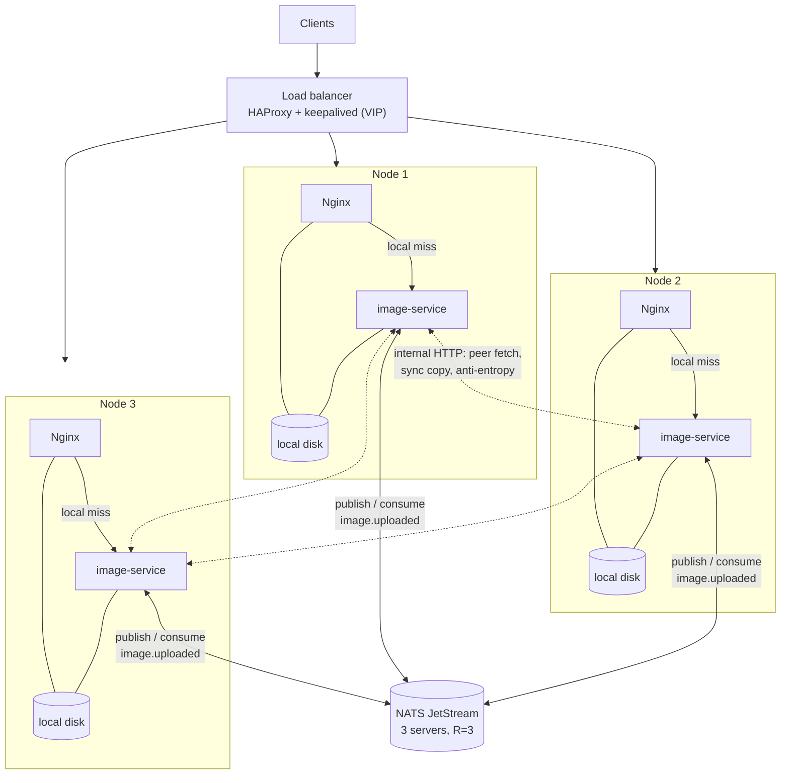
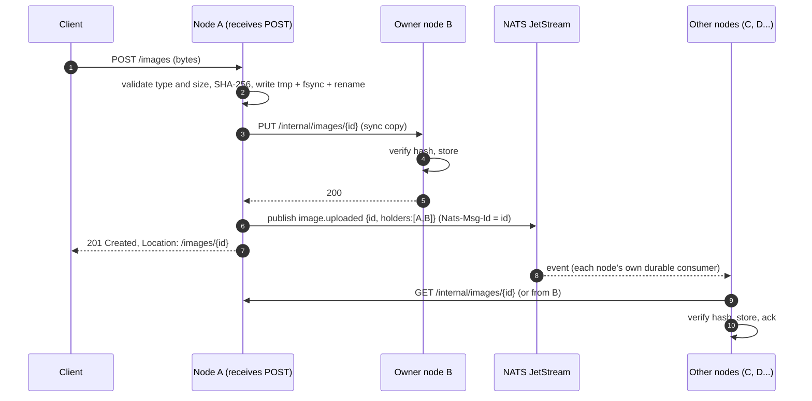
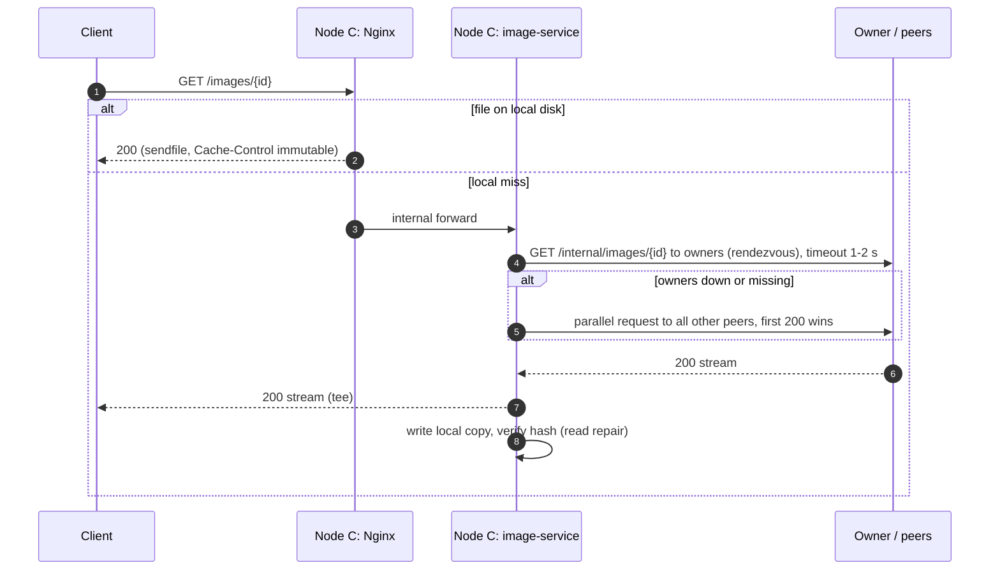
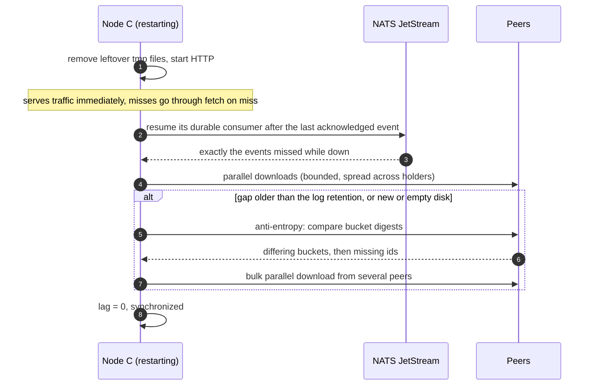

# Images CDN: system design

Design of an on-premise cluster that stores images and serves them over HTTP.

A working prototype of this design, with a live demo, is described in [README.md](README.md).

## Requirements

| # | Requirement | How the design meets it |
| --- | --- | --- |
| R1 | Nodes stay synchronized; a new image (POST) reaches every node as quickly as possible | Upload event on a replication log, which every node consumes. Each node then pulls the bytes from a peer, in parallel. |
| R2 | A GET works on any node, even before that node has the image | Fetch on miss: the node gets the image from a peer that has it, streams it to the client and keeps a copy |
| R3 | A node that restarts resynchronizes as quickly as possible | It resumes the log from its last acknowledged event. Anti-entropy is the fallback. The node serves traffic while it catches up. |
| - | No deletion | The dataset only grows, which makes it much simpler to keep consistent (see below) |

## Key idea: content-addressed, immutable images

The image id is the **SHA-256 of its content**: `GET /images/9f86d081...`.

Because images are immutable, identified by their content and never deleted, the data on each node is a
**grow-only set**:

- **No write conflicts.** Two nodes can never hold different versions of the same id, so there is nothing to
  resolve. Merging two nodes means taking the union of their sets.
- **Every operation is idempotent.** Uploading the same image twice, receiving a replication event twice or
  downloading a file already present has no effect. At-least-once delivery is therefore enough, and every
  mechanism can simply retry.
- **Built-in integrity check.** Each node verifies the hash of every file it receives from a peer.
- **Unlimited HTTP caching.** `Cache-Control: public, max-age=31536000, immutable` and `ETag: <id>`, so browsers
  and any cache in front of the cluster never need to revalidate.

The rest of the design builds on these properties.

## Architecture

All nodes are identical (no leader). Each node has:

| Component | Role |
| --- | --- |
| **Nginx** | Serves `GET /images/{id}` straight from the local disk (sendfile, very fast). On a local miss it forwards the request to the local image-service (`try_files` + internal location). |
| **image-service** (Python/FastAPI) | Upload, fetch on miss, replication consumer, anti-entropy, internal peer API |
| **Local disk** | Content-addressed layout `/data/9f/86/9f86d081...`. Writes go to a temporary file, then fsync and atomic rename, so a partial file is never served. |

Shared components:

| Component | Role |
| --- | --- |
| **Load balancer** | HAProxy pair with keepalived (virtual IP), health checks on `/healthz`, removes dead nodes |
| **NATS JetStream** (3 servers, stream replicated 3 times) | Durable, replayable log of upload events. **Each node has its own durable consumer**, so every node receives every event, and the server records how far each node has acknowledged. |
| **Prometheus + Grafana** | Replication lag, miss rate, peer fetch latency, disk usage |

The log carries **metadata only** (`id`, `size`, `holders`, `uploaded_at`), not the bytes. Images can be several MB
and a log works best with small messages. The bytes are pulled over HTTP directly from the nodes that already have
them.

**Why NATS JetStream:** it provides what the design needs (a durable log, one consumer per node whose position
survives restarts, explicit acknowledgements, redelivery, deduplication by message id). It is also a single binary
that is easy to run on premise. **Kafka** gives the same guarantees, with each node as its own consumer group and a
committed offset. It is a good choice if the company already operates it, but it is heavier to run for this use.

### Owners: rendezvous hashing

For every image, the 2 **owner nodes** are chosen with rendezvous hashing (highest random weight): for each node,
compute `score = hash(node_id + image_id)` and pick the 2 nodes with the highest scores. Any node can compute this
locally with no coordination, and adding or removing a node moves only a small share of the images.

The owners are written **synchronously** during the upload. Any node can therefore compute where an image is
guaranteed to be, even before receiving the replication event.

## Flows

### POST: upload and replication (R1)

- **Durability before the 201:** the image is on at least 2 nodes (write quorum W=2, configurable). A single disk
  failure right after the response does not lose it.
- **Speed:** the event reaches every node within milliseconds. Each node downloads from one of the holders, chosen at
  random so they share the load, with a bounded pool of parallel downloads.
- **At-least-once delivery:** a node acknowledges an event only after the file is fsynced, and waits for the server
  to confirm the acknowledgement. A crash in between means the event is received again, which is harmless because of
  idempotency. Publishing uses the image id as message id, so a retried publish is deduplicated.
- **Log unavailable:** the upload is still accepted. The event goes to a local **outbox** on disk and a background
  task publishes it later. Replication is delayed, but reads still work thanks to fetch on miss.
- **Duplicate upload:** the same bytes give the same id, the node already has the file, and it returns `200` with the
  existing URL.

### GET: serving an image the node does not have yet (R2)

- **Read-your-writes on any node:** after a `201` the owners have the image, and every node can compute who the
  owners are. A GET sent to any node therefore succeeds even if the replication event has not arrived there yet.
- **Single flight:** 100 concurrent requests for the same missing id trigger one peer fetch. The other requests
  wait for its result.
- **Resilience:** short timeouts and a per-peer circuit breaker. A slow or dead node is skipped and the next holder
  is tried, so the problem does not spread to the rest of the cluster.
- The response is streamed to the client while the copy is written, so the client does not wait for the whole file.
  A `404` is returned only if no node in the cluster has the image.

### Node restart: resynchronization (R3)

1. **The node is useful immediately.** It does not need to be fully synchronized to answer, because fetch on miss
   covers the gaps. The load balancer can give it a lower weight until its lag reaches zero.
2. **Fast path, which covers most restarts:** the node's durable consumer records exactly which events it has not
   acknowledged. It receives only those and downloads the files in parallel, with no full scan.
3. **Fallback, anti-entropy:** used when the node was down for longer than the log retention (for example 7 days),
   when its disk was replaced, or when a new node joins the cluster. Ids are split into 4096 buckets by their first
   3 hex characters, and each node keeps a digest per bucket. Comparing 4096 digests with a peer shows which buckets
   differ, and only the ids in those buckets are listed and downloaded. The downloads are spread across several peers.
4. **Safety net:** the same anti-entropy runs periodically (for example every hour) on every node. It repairs gaps
   the log could not prevent, such as bugs or corrupted files. A background scrub also re-verifies file hashes.

## Failure scenarios

| Scenario | Behaviour |
| --- | --- |
| A node dies | The load balancer removes it. Its images are on every other node, and new uploads use the next owner in rendezvous order. |
| Upload node dies right after the `201` | The owner has the copy. The event is already in the log, or anti-entropy finds the image. |
| Log (NATS) unavailable | Uploads accepted through the outbox, GET works, replication delayed and then caught up. |
| Slow peer | Timeout and circuit breaker, then the next holder is tried. |
| Network partition | Both sides keep accepting uploads. Content-addressed ids cannot conflict, so after the partition heals the log and anti-entropy merge the two sides. |
| Corrupted file | Hash checked on every transfer and by the scrub. The file is fetched again from a peer. |
| Disk almost full | Alert. Uploads are rejected with `507` before the disk is completely full. |

## Trade-offs

- **Eventual consistency, chosen deliberately (AP in CAP terms).** The requirement says "as quickly as possible", not
  "atomically on every node". Waiting for every node before answering a POST would make uploads slow and would block
  them as soon as one node is down. What I guarantee instead: the image is durable on 2 nodes before the `201`,
  readable from every node immediately (fetch on miss), and fully replicated within seconds.
- **Full replication.** Every node stores every image, as the requirement asks. Reads scale with the number of
  nodes, but total capacity equals the disk of a single node. If the dataset grows beyond that, the same rendezvous
  hashing lets the cluster move to partial replication (each image on R nodes) with no change to the API.
- **Durable log vs direct push.** Pushing directly to peers has fewer components, but an event missed while a node was
  down is lost. A durable log that can be replayed from a given point is what makes the fast resync (R3) simple.
- **Metadata on the log, bytes over HTTP.** This keeps the log small and fast, and each image is transferred only
  between nodes.

## API

| Method | Path | Result |
| --- | --- | --- |
| `POST` | `/images` | `201` `{id, url}` + `Location`, `200` if already present, `413` too large, `415` not an image |
| `GET`/`HEAD` | `/images/{id}` | `200` + `ETag` + immutable cache headers, `404` if no node has it |
| `PUT` | `/internal/images/{id}` | synchronous copy to an owner (internal network only) |
| `GET` | `/internal/images/{id}` | peer fetch |
| `GET` | `/internal/buckets`, `/internal/buckets/{prefix}` | anti-entropy digests and id lists |
| `GET` | `/healthz`, `/metrics` | load balancer health check, Prometheus metrics |

## Monitoring

- **Replication lag** per node (pending events of its durable consumer). This is the main indicator for R1 and R3.
- **Local miss rate** and peer-fetch latency (R2). A high miss rate on one node means it is behind.
- Anti-entropy: number of buckets that differ, number of images repaired.
- Upload and read p99 latency, error rates, disk usage, and circuit breakers currently open.
